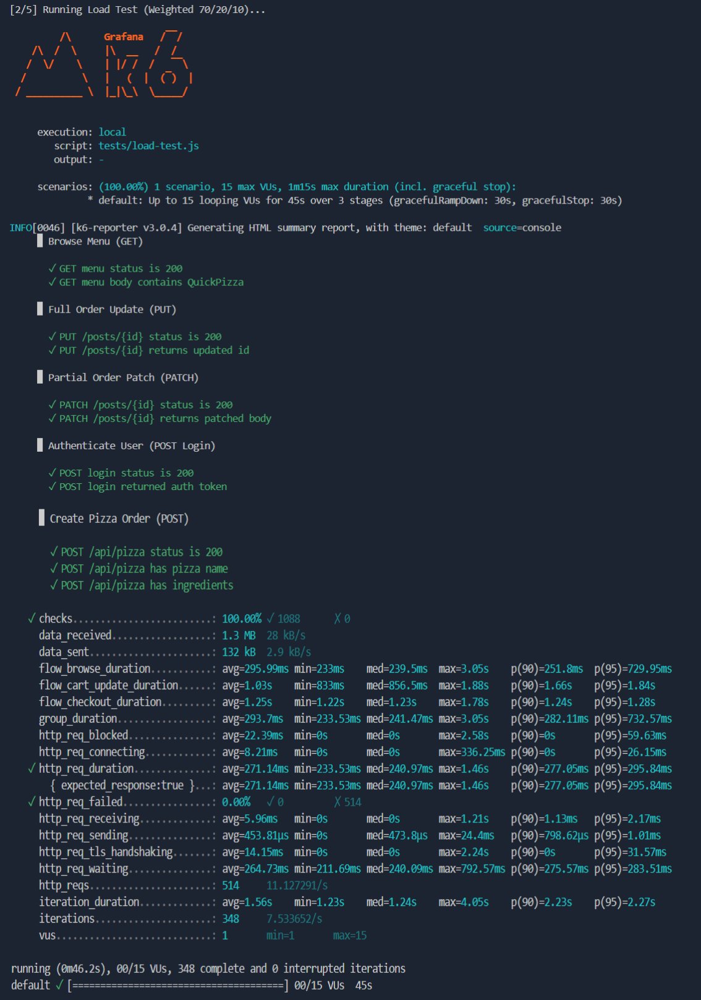
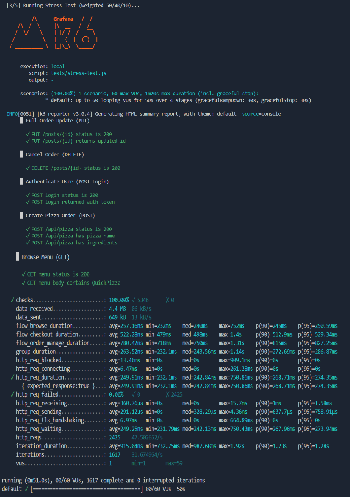
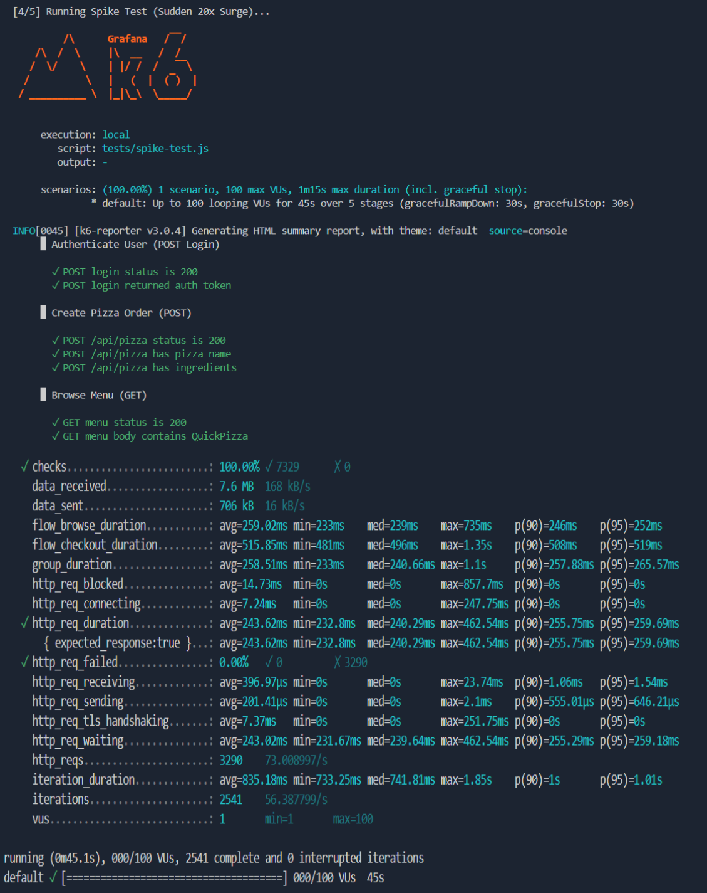
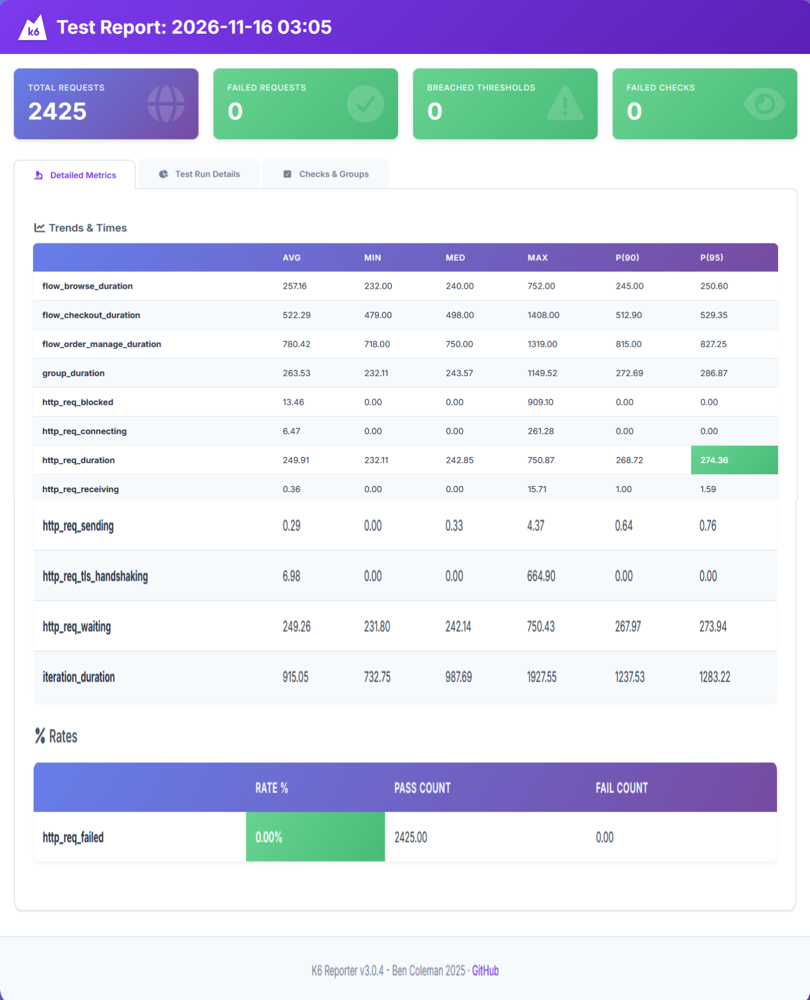

# k6 Performance Testing — QuickPizza API


-F7DF1E?logo=javascript&logoColor=black)

A portfolio project using **Grafana k6** to practice API performance testing across five scenarios: Smoke, Load, Stress, Spike, and Data-Driven.

> **Scope Note:** QuickPizza handles the `GET` and `POST` flows; JSONPlaceholder handles the `PUT`, `PATCH`, and `DELETE` examples. They are separate demo services, not one connected CRUD workflow.

## Project Overview

| API target | Purpose | Endpoints / methods |
|---|---|---|
| [QuickPizza](https://quickpizza.grafana.com) | Browse menu, retrieve a login token, and submit a pizza request | `GET /`, `GET /?menu={tag}`, `POST /api/users/token/login`, `POST /api/pizza` |
| [JSONPlaceholder](https://jsonplaceholder.typicode.com) | Demonstrate resource update and delete requests | `PUT`, `PATCH`, `DELETE /posts/{id}` |

### Key implementation features

- **Token correlation:** extracts the returned QuickPizza login token and passes it in the pizza request's `Authorization` header, with fallback handling.
- **Shared data:** loads 10 JSON order profiles with k6 `SharedArray`; iterations select records cyclically by index.
- **Custom Trend metrics:** `flow_browse_duration`, `flow_checkout_duration`, `flow_cart_update_duration`, and `flow_order_manage_duration` track business-flow durations.
- **Weighted workloads:** Load, Stress, and Spike use probability-based flow selection.
- **Response validation:** checks HTTP status codes and selected response content, including token and pizza fields.
- **HTML reporting:** each test writes `reports/<test-name>-summary.html` through `k6-reporter`.
- **Environment variables:** supports API URL overrides and QuickPizza login values.
- **GitHub Actions:** runs Smoke and Data-Driven tests on pushes and pull requests to `main` or `master`.

## Test Scenarios & Configuration

| Scenario | VU stages / profile | Duration | Workload and methods |
|---|---|---:|---|
| **Smoke** | 2 fixed VUs | 10 s | Browse, login, pizza request, then JSONPlaceholder update/delete examples; `GET`, `POST`, `PUT`, `PATCH`, `DELETE` |
| **Load** | 0→15 (10 s), hold 25 s, 15→0 (10 s) | 45 s | 70% browse, 20% checkout, 10% cart update; `GET`, `POST`, `PUT`, `PATCH` |
| **Stress** | 0→15 (10 s) →35 (15 s) →60 (15 s) →0 (10 s) | 50 s | 50% browse, 40% checkout, 10% update/delete; `GET`, `POST`, `PUT`, `DELETE` |
| **Spike** | 0→5 (10 s), 5→100 (5 s), hold 15 s, 100→5 (5 s), 5→0 (10 s) | 45 s | 70% browse, 30% checkout; `GET`, `POST` |
| **Data-Driven** | 0→10 (5 s), hold 20 s, 10→0 (5 s) | 30 s | Uses JSON order profiles for menu search, login, pizza request, PUT, and PATCH; `GET`, `POST`, `PUT`, `PATCH` |

### Project-defined k6 thresholds

| Scenario | `http_req_duration` P95 | `http_req_failed` | `checks` |
|---|---:|---:|---:|
| Smoke | `< 2,000 ms` | `< 1%` | `> 99%` |
| Load | `< 1,500 ms` | `< 1%` | `> 99%` |
| Stress | `< 2,500 ms` | `< 5%` | `> 99%` |
| Spike | `< 3,000 ms` | `< 5%` | `> 99%` |
| Data-Driven | `< 1,500 ms` | `< 1%` | `> 99%` |

## Captured Test Results

| Test | HTTP requests | P95 | Failed requests | Checks passed |
|---|---:|---:|---:|---:|
| Smoke | 24 | 904.10 ms | 0% (0) | 48/48 (100%) |
| Load | 514 | 295.84 ms | 0% (0) | 1,088/1,088 (100%) |
| Stress | 2,425 | 274.35 ms | 0% (0) | 5,346/5,346 (100%) |
| Spike | 3,290 | 259.69 ms | 0% (0) | 7,329/7,329 (100%) |
| Data-Driven | 435 | 289.11 ms | 0% (0) | 957/957 (100%) |

## Repository Structure

```text
k6-performance-testing/
├── .github/workflows/k6-ci.yml
├── data/pizza-orders.json        # 10 order profiles
├── reports/.gitkeep              # Generated reports are gitignored
├── screenshots/                  # Terminal and HTML report evidence
├── tests/                         # Five k6 test scripts
├── utils/helpers.js               # Shared requests, checks, and summary handler
├── run-all-tests.bat              # Windows runner
├── run-all-tests.sh               # macOS / Linux runner
├── .gitignore
└── README.md
```

## Getting Started

**Prerequisite:** Install [Grafana k6](https://grafana.com/docs/k6/latest/set-up/install-k6/) and ensure access to the demo APIs and the remote JavaScript libraries imported by `utils/helpers.js`.

```bash
# Verify installation
k6 version

# Run an individual scenario from the repository root
k6 run tests/smoke-test.js
k6 run tests/load-test.js
k6 run tests/stress-test.js
k6 run tests/spike-test.js
k6 run tests/data-driven-test.js

# Run all scenarios on macOS / Linux
chmod +x run-all-tests.sh
./run-all-tests.sh
```

On Windows Command Prompt, run `run-all-tests.bat`. Each test writes an HTML summary to `reports/` (`smoke-summary.html`, `load-summary.html`, `stress-summary.html`, `spike-summary.html`, or `data-driven-summary.html`). Generated HTML reports are excluded by `.gitignore`.

### Environment variables

| Variable | Default |
|---|---|
| `QUICKPIZZA_URL` | `https://quickpizza.grafana.com` |
| `PLACEHOLDER_URL` | `https://jsonplaceholder.typicode.com` |
| `QP_USERNAME` | `default` |
| `QP_PASSWORD` | `default` |

Example: `QP_USERNAME="your-username" QP_PASSWORD="your-password" k6 run tests/smoke-test.js` (macOS / Linux).

## Continuous Integration

`.github/workflows/k6-ci.yml` runs on pushes to `main` / `master` and pull requests targeting those branches. It executes `tests/smoke-test.js` and `tests/data-driven-test.js`, then uploads `reports/` as the `k6-performance-reports` artifact with a 14-day retention period.

## Evidence — expand a section to view each capture

<details>
<summary>Smoke Test — terminal output</summary>

</details>

<details>
<summary>Load Test — terminal output</summary>

</details>

<details>
<summary>Stress Test — terminal output</summary>

</details>

<details>
<summary>Spike Test — terminal output</summary>

</details>

<details>
<summary>Data-Driven Test — terminal output</summary>

</details>

<details>
<summary>Stress Test — HTML summary report</summary>

</details>

## Limitations & Disclaimer

- Tests target public demo services; results are individual captured runs and may vary. P95 is aggregated across requests, not reported per endpoint.
- The project validates client-visible HTTP responses only; it does not include server-side monitoring, database verification, or infrastructure metrics. Thresholds are practice criteria, not provider SLAs.
- The QuickPizza login helper uses a fallback token when no token is returned; that fallback does not establish a successfully authenticated session.
- The Windows batch runner continues through commands without a consolidated failure status; the shell runner stops on the first failed command.
- Use modest load against public demos. Run high-volume tests only against systems you own or are explicitly authorized to test.
