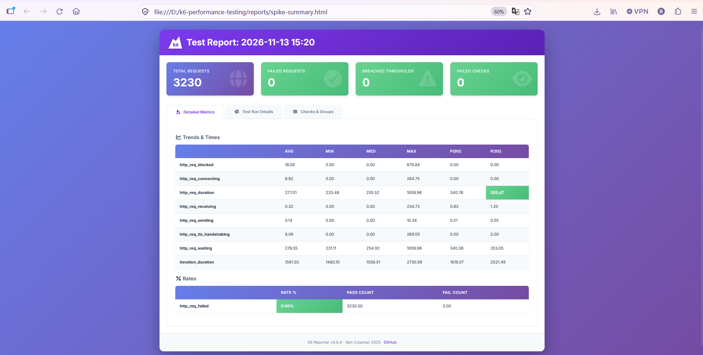
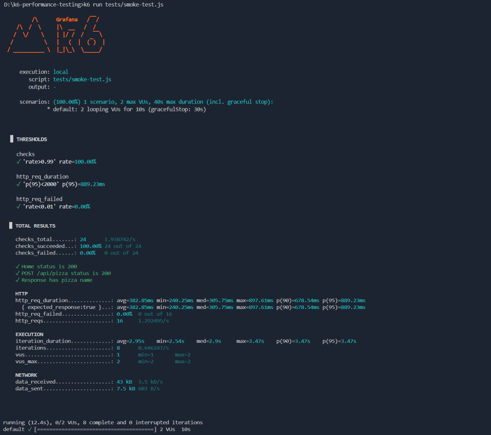
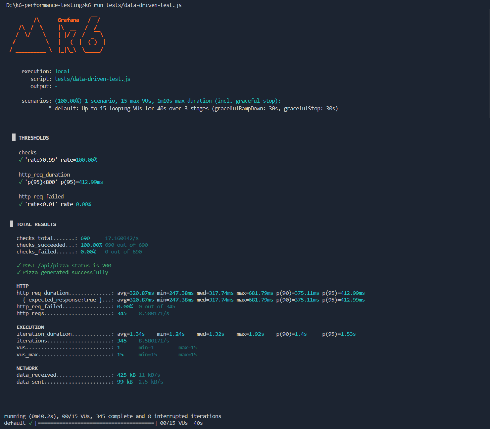

# QuickPizza API Performance & Load Testing Suite (Grafana k6)


-F7DF1E?logo=javascript&logoColor=black)

An end-to-end API performance, load, stress, and spike testing framework built with **Grafana k6**, targeting the [QuickPizza API](https://quickpizza.grafana.com). This repository demonstrates modern performance engineering practices—including multi-stage traffic simulation, data parameterization (`SharedArray`), automated SLA threshold assertions, HTML reporting, and Continuous Integration via GitHub Actions.



---

## Key Highlights & Engineering Features

* **Comprehensive Test Coverage:** Five dedicated test suites covering **Smoke**, **Load**, **Data-Driven**, **Stress**, and **Spike** testing scenarios.
* **Data Parameterization:** Uses k6's `SharedArray` to load randomized order payloads from an external JSON dataset (`data/pizza-orders.json`), so requests vary between iterations instead of repeating one identical payload.
* **Automated SLA Enforcement (`Thresholds`):** Built-in pass/fail quality gates enforcing strict 95th percentile (`p95`) response time limits, check pass rates, and near-zero HTTP failure rates.
* **Transactional API Validation:** Simulates realistic user journeys (`GET /` followed by authenticated `POST /api/pizza` requests) with deep JSON payload assertions.
* **Automated HTML Visual Reporting:** Integrated with `k6-reporter` to automatically generate interactive HTML dashboards (`reports/spike-summary.html`).
* **Continuous Integration (CI):** Configured with **GitHub Actions** (`.github/workflows/k6-ci.yml`) to automatically execute smoke tests on every push and pull request to `main`.

---

## Repository Structure

```text
k6-performance-testing/
├── .github/
│   └── workflows/
│       └── k6-ci.yml            # GitHub Actions workflow for automated CI smoke testing
├── data/
│   └── pizza-orders.json        # Parameterized JSON payloads for data-driven testing
├── tests/
│   ├── smoke-test.js            # Baseline health & script verification (2 VUs, 10s)
│   ├── load-test.js             # Normal daily traffic simulation (10 VUs, 40s)
│   ├── data-driven-test.js      # Randomized payload load test via SharedArray (15 VUs, 40s)
│   ├── stress-test.js           # High-load capacity & breaking-point testing (50 VUs, 50s)
│   └── spike-test.js            # Sudden flash-sale surge simulation (5 -> 120 VUs, 45s)
├── reports/
│   └── spike-summary.html       # Auto-generated HTML visual test summary
├── screenshots/
│   ├── spike-report.png         # Preview of the HTML performance dashboard
│   ├── smoke-test-terminal.png  # k6 terminal summary: smoke test
│   ├── load-test-terminal.png   # k6 terminal summary: load test
│   ├── data-driven-test-terminal.png  # k6 terminal summary: data-driven test
│   └── stress-test-terminal.png # k6 terminal summary: stress test
├── .gitignore
└── README.md
```

---

## Performance Benchmark Summary

All test suites were executed against `https://quickpizza.grafana.com` and validated against predefined Service Level Agreements (SLAs):

| Test Scenario | Peak VUs | Total Requests | Throughput (RPS) | Avg Latency | p(95) Latency | Error Rate | SLA Threshold | Status |
| :--- | :---: | :---: | :---: | :---: | :---: | :---: | :---: | :---: |
| **Smoke Test** | 2 | 16 | 1.29 req/s | 382.85 ms | 889.23 ms | 0.00% | `p(95) < 2000ms` | PASS |
| **Load Test** | 10 | 242 | 6.02 req/s | 287.41 ms | 384.60 ms | 0.00% | `p(95) < 800ms` | PASS |
| **Data-Driven Test** | 15 | 345 | 8.58 req/s | 320.87 ms | 412.99 ms | 0.00% | `p(95) < 800ms` | PASS |
| **Stress Test** | 50 | 1,548 | 30.49 req/s | 278.09 ms | 353.88 ms | 0.00% | `p(95) < 1500ms` | PASS |
| **Spike Test** | 120 | 3,230 | 69.92 req/s | 277.01 ms | 353.47 ms | 0.00% | `p(95) < 2000ms` | PASS |

Every suite also enforces `http_req_failed` (error rate) and `checks: rate > 0.99` thresholds, and all checks passed in each run.

### Key Analytical Findings
1. **High Resilience Under Sudden Traffic Surges:** During the **Spike Test** (an abrupt 24x jump from 5 to 120 concurrent virtual users within 5 seconds), the target endpoint successfully processed **3,230 requests** at **69.92 req/s** with **0.00% HTTP errors** and **100% functional check pass rates**.
2. **Stable Latency Under Varied Payloads:** During the **Data-Driven Test**, latency stayed stable under randomized JSON payloads (`p(95)` at **412.99 ms**), indicating consistent API response times when requests vary.

### Notes
* **Test Target & Environment:** All benchmarks target Grafana's public demo service ([QuickPizza](https://quickpizza.grafana.com)) and were executed from a local client machine (which includes public internet network latency). Therefore, the recorded metrics are indicative of end-to-end client-side behavior rather than isolated internal server capacity.
* **Concurrent Runs:** Some suites were run at the same time in separate terminals on the same machine, so shared local resources and network bandwidth may have influenced individual results (for example the smoke test p(95)). For isolated numbers, run each suite on its own.

---

## Test Run Screenshots

Terminal summaries from the k6 runs (thresholds, checks, and HTTP metrics):

| Smoke Test | Load Test |
| :---: | :---: |
|  |  |

| Data-Driven Test | Stress Test |
| :---: | :---: |
|  |  |

---

## Getting Started

### Prerequisites
* [Grafana k6](https://grafana.com/docs/k6/latest/set-up/install-k6/) installed locally:
  * **Windows:** `winget install k6 --source winget`
  * **macOS:** `brew install k6`

### Installation & Execution
1. **Clone the repository:**
   ```bash
   git clone https://github.com/obyy47/k6-performance-testing.git
   cd k6-performance-testing
   ```

2. **Run individual test suites:**
   ```bash
   # 1. Baseline Smoke Test
   k6 run tests/smoke-test.js

   # 2. Normal Load Test
   k6 run tests/load-test.js

   # 3. Data-Driven Load Test (SharedArray)
   k6 run tests/data-driven-test.js

   # 4. High-Load Stress Test
   k6 run tests/stress-test.js

   # 5. Extreme Spike Test (generates HTML report)
   k6 run tests/spike-test.js
   ```

3. **Inspect the Visual Report:**
   After running `tests/spike-test.js`, open `reports/spike-summary.html` in any web browser to view detailed latency percentiles, request rates, and check breakdowns.